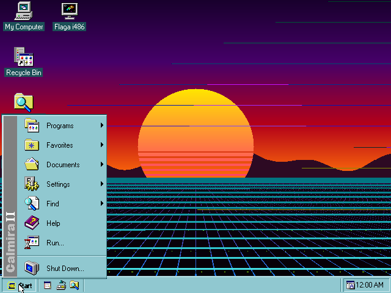
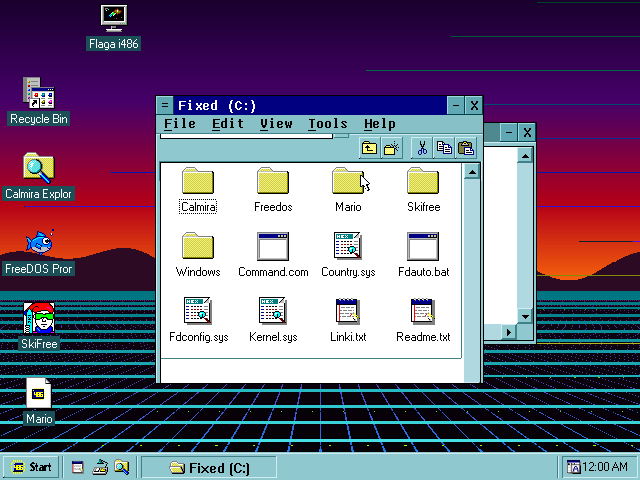

# Calmira II (FPC Port)

**Calmira II** (Online! Release 3.3) — the classic Windows 95-style desktop shell for 16-bit Windows 3.1x — adapted to build with a 100% open-source toolchain using **Free Pascal Compiler (`i8086-win16`)**, [**WUIL**](https://github.com/mztulip/wuil_fpc), and the **Open Watcom** linker (`wlink`), without requiring Borland Delphi 1.0.





*Screenshots captured from the FPC-compiled Calmira II running on [`win16Loader`](https://github.com/mztulip/win16Loader).*

---

## Original Project

This repository is based on the original **Calmira II (Online! Release 3.3)** source code:

- **Original website:** [http://www.calmira.de/](http://www.calmira.de/)
- **Original authors:**
  - Copyright (C) 1997–1998 Li-Hsin Huang
  - Copyright (C) 1998–2002 Calmira Online!

## Repository Structure

- `SRC/` — Calmira II shell source code (`CALMIRA.DPR` and units)
- `VCL/` — Calmira custom VCL components
- `BMP/`, `HELP/` — Bitmaps and help assets
- `wuil/` *(submodule: [`mztulip/wuil_fpc`](https://github.com/mztulip/wuil_fpc))* — Open-source Delphi 1.0 VCL-compatible GUI library for `i8086-win16`
- `fpc-source/` *(submodule: [`mztulip/FPCSource`](https://github.com/mztulip/FPCSource))* — Free Pascal Compiler fork with `i8086-win16` HUGE memory model (`-WmHUGE`) and Delphi 1.0 compatibility fixes

## Cloning

Clone the repository together with the `wuil` and `fpc-source` submodules:

```bash
git clone --recursive https://github.com/mztulip/calmira_fpc.git
cd calmira_fpc
```

If you already cloned without `--recursive`, initialize the submodules with:

```bash
git submodule update --init --recursive
```

## Building from Source

### Prerequisites

- **Linux x86_64** host with **GNU Make**
- **Host Free Pascal Compiler (`fpc`)** (e.g. FPC 3.2.2) to bootstrap the `i8086` cross-compiler
- **Open Watcom** (`wlink`, `wlib`, `wrc`) installed in `/opt/watcom` (or set `WATCOM` accordingly)

### Step 1: Build the `i8086-win16` Cross-Compiler (`ppcross8086`)

From the repository root:

```bash
make -C fpc-source/compiler i8086
```

This builds `fpc-source/compiler/ppcross8086`.

### Step 2: Build the Win16 RTL (HUGE Memory Model, i486)

```bash
make -C fpc-source/rtl/win16 \
    OS_TARGET=win16 CPU_TARGET=i8086 \
    PP="$PWD/fpc-source/compiler/ppcross8086" \
    OPT="-Cp80486 -Op80486 -Wh -WmHUGE -CX -XX"
```

This builds the Win16 RTL units in `fpc-source/rtl/units/win16` with HUGE memory model (`-WmHUGE`, giving each unit its own FAR data segment to exceed the 64 KB `DGROUP` limit) and per-procedure code sections (`-Wh`).

### Step 3: Compile Calmira II

Run the helper wrapper [`wuil/fpc16`](wuil/fpc16) from the repository root:

```bash
./wuil/fpc16 -Mdelphi -CX -XX \
    -FuSRC -FuVCL -Fuwuil \
    -FiSRC -FiVCL \
    SRC/CALMIRA.DPR
```

This compiles and links all 80+ Calmira units into a 16-bit Windows New Executable (`SRC/CALMIRA.exe`).

### Step 4: Bind Resources and Forms (`.RES` / `.DFM`)

Attach the original Calmira resources and Delphi forms using Open Watcom `wrc`:

```bash
WATCOM=/opt/watcom ./wuil/bindres SRC/CALMIRA.exe
```

> **Note:** Without this step, `SRC/CALMIRA.exe` will not contain its embedded `.DFM` forms, icons, or bitmaps.

The resulting `SRC/CALMIRA.exe` can be run on Windows 3.1x or under [`win16Loader`](https://github.com/mztulip/win16Loader).

## License

- **Calmira II (`SRC/`, `VCL/`, `BMP/`, `HELP/`)** is licensed under the **GNU General Public License v2.0 (or later)** — see [`LICENSE`](LICENSE).
- Submodules [`wuil`](https://github.com/mztulip/wuil_fpc) (MIT) and [`fpc-source`](https://github.com/mztulip/FPCSource) (GPL / modified LGPL) retain their own respective licenses.
